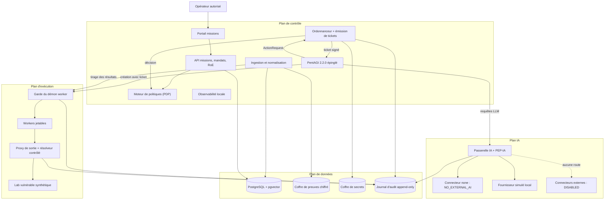
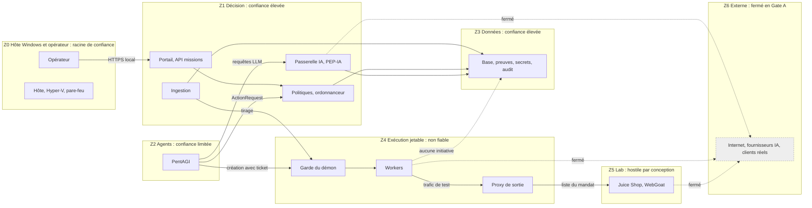
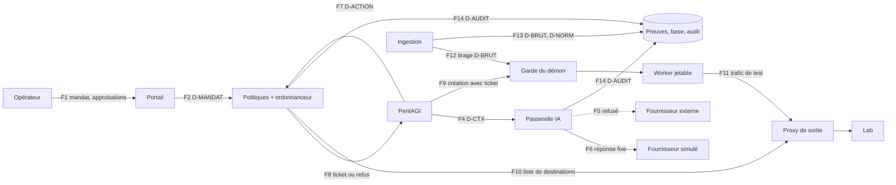
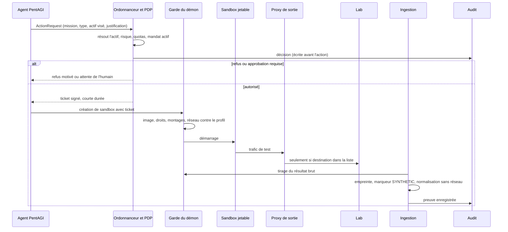
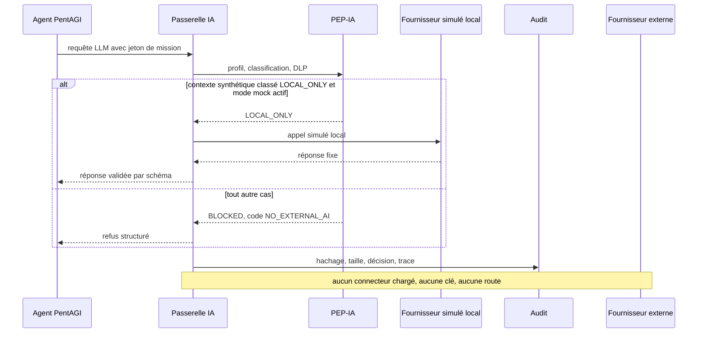

# 01-architecture — Plateforme de pentest autorisé automatisé, Gate A (option O3) — 20261102

> **Provenance.** Agent émetteur : redacteur (famille sonnet ; la version servie se lit au ledger du run, champ `modele_version`).
> Verdict d'arbitre : `oracle-ecriture` 1.1.0 PASS (exit 0 ; EC-7, EC-10, EC-12 et EC-14 en SKIP, sans constat sur le texte), commande `node oracles/oracle-ecriture.mjs` sur ce fichier le 2026-11-02. Relecture contre la définition du CDC §0 l.35 faite à la main : aucun oracle d'architecture n'existe, la cohérence n'est donc pas validée par un oracle de domaine (§16).
> Hypothèses non résolues : HB-1 compte OpenAI, résidence hors États-Unis et contrôles de rétention (approbation préalable, invérifiable depuis ce poste) ; HB-2 programme Daybreak ; HB-3 droit de créer des VM Hyper-V depuis la session (refusé à la mesure) ; HB-4 état du chiffrement de disque de l'hôte (accès refusé) ; HB-5 destination des sauvegardes hors hôte (décision du porteur). Les hypothèses ASSUMED sont au registre du §15.

**Lecteurs :** le porteur, la DSI, et la session qui rédigera les documents 02 à 09 du CDC (cahier des charges) à partir de celui-ci. **Date :** 2026-11-02. **Nature :** conception hors ligne de l'option O3 de l'étude d'opportunité. Aucun code exécutable, aucun appel d'API, aucun flux vers un modèle externe (mode `NO_EXTERNAL_AI`), aucune donnée client, aucune cible réelle. Seules des lectures passives du poste ont eu lieu (§2). Le texte décrit des contrôles défensifs et ne contient aucune méthode d'attaque.

Sources citées : le **CDC** est `input\CLAUDE_CODE_PENTEST_ARCHITECTURE (1).md` (v1.1), l'**étude** est `output\03-etudes\Digit-AI - Etude - Opportunite plateforme pentest autorise automatise - 20261102p.md` (verdict SOUS-CONDITION, option O3). Ce document ne contredit pas l'étude. Trois statuts qualifient chaque hypothèse, au sens du CDC §18.3 l.769 : VERIFIED (mesuré ou lu à la source, rejouable), ASSUMED (repris d'un texte ou conçu, non vérifié), BLOCKED (invérifiable depuis ce poste ou suspendu à une décision humaine ; rien n'est bâti dessus).

## Ce qui change pour le lecteur

Gate A peut se construire sur ce poste, avec quatre décisions d'architecture et une limite que rien ne lève.

1. Les quatre plans (contrôle, données, exécution, IA) tiennent dans des segments réseau distincts, chacun fermé par défaut. Aucun worker n'ouvre de connexion vers le contrôle ou les données : le contrôle va chercher les résultats.
2. Aucune règle de sécurité ne repose sur un prompt. Le PEP (Policy Enforcement Point, point qui applique une décision hors du modèle) existe en deux exemplaires côté serveur : PEP-Action pour les actions techniques, PEP-IA dans la passerelle. Un filtre réseau indépendant double PEP-Action.
3. En Gate A la passerelle IA tourne en `NO_EXTERNAL_AI` : aucun connecteur externe n'est chargé, aucune route sortante n'existe. Le seuil « fuite = 0 » se démontre sur fixtures synthétiques (§12).
4. PentAGI 2.2.0 est épinglé par tag et digest, `DOCKER_INSIDE=false`, et n'atteint jamais le démon Docker de l'hôte. Ce démon héberge déjà 47 conteneurs, dont ceux d'autres produits (VERIFIED, §2), la plateforme n'y touche pas.

La limite : tout repose sur un seul hôte Windows. Sa compromission annule les séparations des §4 à §6. L'usage reste donc une mission synthétique à la fois, sans prétention multi-client (§13, CDC §7.3 l.400).

Quatre écarts au schéma du CDC §2 (l.85-104) sont proposés et doivent passer en ADR (Architecture Decision Record, fiche de décision d'architecture, `05-decisions.md`) : ingestion par tirage plutôt que dépôt par les workers, VM de sortie réseau dédiée, VM de lab séparée du pool de workers, zone des agents distincte de la zone de décision. Chacun est justifié à l'endroit où il apparaît.

## 1. Modes de fonctionnement et règle d'échec

Le CDC impose trois modes (§0 l.23). Le tableau fixe leur état en Gate A.

| Mode | Trafic vers une cible | IA externe | État en Gate A |
|---|---|---|---|
| analyse seule | aucun | `NO_EXTERNAL_AI` | actif, données synthétiques |
| lab | vers le lab seulement | `NO_EXTERNAL_AI` | actif |
| mission autorisée | vers les actifs d'un mandat signé | selon le profil de confidentialité | désactivé : aucun mandat réel, aucune qualification fournisseur (Gate B) |

La règle d'échec est celle du CDC §0.3 l.21, appliquée à chaque composant : une incertitude sur le périmètre, l'autorisation, la classification ou la disponibilité d'un contrôle produit un refus, jamais une dégradation vers une option moins sûre. 4 cas en découlent.

- Moteur de politiques injoignable ou règle illisible : action refusée.
- Écriture d'audit impossible : action refusée (l'audit précède l'action).
- Classification absente sur un contexte destiné à l'IA : verdict `BLOCKED`.
- Proxy de sortie injoignable : le worker n'a aucune autre route, le trafic s'arrête.

## 2. Faits de départ

Les mesures du 2026-11-02 viennent de l'étape 0 de l'étude (l.87) et de quatre lectures passives complémentaires faites pour ce document, entre 15:42 et 15:45 (+0100). Aucune n'a modifié le poste.

| Fait | Statut | Source |
|---|---|---|
| Intel Core Ultra X7 358H, 16 cœurs et 16 threads ; RAM 63,5 Go ; disque C: 318,9 Go libres sur 1880 Go | VERIFIED | étude l.87 |
| Windows 11 Pro build 26300 ; `HypervisorPresent` = True | VERIFIED | étude l.87 |
| GPU : Intel Arc B390 seul, pas de RTX 3090 ; inférence locale hors de portée | VERIFIED | étude l.87 |
| WSL2 : une seule distribution, `docker-desktop`, version 2, en exécution | VERIFIED | `wsl --list --verbose`, 15:42 |
| Docker 29.4.2, système « Docker Desktop », options de sécurité seccomp par défaut et cgroupns, pas rootless | VERIFIED | `docker info --format`, 15:42 |
| Services Hyper-V `vmms` (Automatic) et `vmcompute` en exécution, cmdlet `Get-VM` présente | VERIFIED | `Get-Service`, 15:43 |
| La session ne peut ni lister les VM ni lire l'état des fonctionnalités Windows (droit ou élévation manquant) | VERIFIED, d'où HB-3 | `Get-VM` et `Get-WindowsOptionalFeature` refusés, 15:42-15:43 |
| État de BitLocker non lisible : accès refusé | VERIFIED, d'où HB-4 | `Get-BitLockerVolume`, 15:45 |
| Le démon Docker Desktop porte 47 conteneurs (arrêtés compris) et 109 images distinctes ; les 10 premiers noms de conteneur relevés sont ceux de produits sans rapport avec la plateforme, et aucun nom ne contient pentagi, juice, webgoat, vxcontrol, kali ni nmap | VERIFIED pour les comptes et la recherche de noms ; l'origine des 37 autres conteneurs n'est pas relevée | `docker ps -a`, `docker ps -a -q`, `docker images -q`, `grep` des noms, 15:44 |
| Une image `ghcr.io/zaproxy/zaproxy:stable` est présente sur ce démon ; son tag est mobile | VERIFIED | `docker images`, 15:44 |
| PentAGI v2.2.0 publiée le 2026-10-05, notes « closes CVE-2026-14784 » ; jusqu'à 2.1.0, `DOCKER_INSIDE=true` dans `.env.example` montait le socket hôte dans chaque sandbox | VERIFIED à la source des releases (relevé de l'étude) | étude l.86 |
| Digest de l'image PentAGI 2.2.0 | non relevé | HA-11, §15 |

Conséquence directe : aucun composant de la plateforme n'est installé. Tout ce qui suit et qui n'est pas dans ce tableau est ASSUMED tant qu'une preuve d'installation ne le promeut pas.

## 3. Architecture logique : quatre plans

Le CDC sépare les plans au §2.1 (l.108-113). Le diagramme 1 y ajoute les composants que ce document précise. L'arête en pointillé est une route qui n'existe pas en Gate A.

### 3.1 Composants par plan

Aucun n'est installé (§2). Les colonnes « Statut » portent l'hypothèse sur l'installabilité sur ce poste.

| Plan | Composant | Rôle | Statut |
|---|---|---|---|
| Contrôle | Portail missions | accès opérateur, création de mission, approbations ; authentification locale en Gate A, SSO et MFA en phase 5 (CDC §9 l.467) | ASSUMED |
| Contrôle | API missions et mandats (`services/mission-api`) | mission, mandat, RoE (Rules of Engagement, règles d'engagement), actifs approuvés | ASSUMED |
| Contrôle | Moteur de politiques | décide périmètre, risque, approbation ; OPA/Rego est un candidat du CDC §2.2 l.122 | ASSUMED |
| Contrôle | Ordonnanceur | résout les actions, émet des tickets signés, commande l'arrêt d'urgence | ASSUMED |
| Contrôle | PentAGI 2.2.0 | runtime des agents, jugé non fiable par son contenu (§9) | ASSUMED installable, version VERIFIED publiée |
| Contrôle | Ingestion | tire les résultats bruts, recalcule l'empreinte, normalise dans un conteneur sans réseau ni secret | ASSUMED |
| Données | PostgreSQL + pgvector | mémoire métier et métadonnées, locales (CDC §3.4 l.199) | ASSUMED |
| Données | Coffre de preuves chiffré | résultats bruts, empreintes SHA-256, chaîne de conservation (CDC §6.3) | ASSUMED |
| Données | Coffre de secrets | Vault ou équivalent (CDC §2.2 l.126) ; en Gate A, secrets fictifs seulement | ASSUMED |
| Données | Journal d'audit | append-only, chaîné par empreintes, sans payload brut | ASSUMED |
| Exécution | Garde du démon worker | proxy d'autorisation devant le démon Docker de la VM worker (§9, §10) | ASSUMED |
| Exécution | Workers jetables | environnements d'outils, un par job (§10) | ASSUMED |
| Exécution | Proxy de sortie et résolveur | seule passerelle réseau entre workers et cibles (§6) | ASSUMED |
| Exécution | Lab | Juice Shop et WebGoat, volontairement vulnérables (§11) | ASSUMED |
| IA | Passerelle IA et PEP-IA | classification, DLP (Data Loss Prevention, détection de fuite), routage, budget (§8) | ASSUMED |
| IA | Fournisseur simulé local | répond par des réponses fixes, pour exercer les chemins de code sans sortie | ASSUMED |
| IA | Connecteurs externes (OpenAI UE, autres) | déclarés, état `DISABLED` | BLOCKED (HB-1, HB-2) |

## 4. Zones de confiance

Une zone regroupe des composants qui se font mutuellement le même degré de confiance. Le diagramme 2 montre les sept zones et les seuls passages autorisés en Gate A. Les flèches pointillées sont des passages fermés.

| Zone | Contenu | Confiance et raison | Entrées admises | Sorties admises |
|---|---|---|---|---|
| Z0 | poste de l'opérateur, hôte Windows, outil de développement | racine de confiance, non isolable de ce qu'il héberge (§13) | aucune hors saisie de l'opérateur | HTTPS local vers le portail |
| Z1 | portail, API missions, moteur de politiques, ordonnanceur, passerelle IA, ingestion | élevée ; seule zone qui décide | requêtes de Z0 et Z2 sur des API étroites | Z3 ; ordres signés vers Z4 ; rien vers Z6 |
| Z2 | PentAGI | limitée : il lit du contenu de cible, et l'éditeur écrit que l'injection de prompt ne peut pas être fermée complètement (étude l.86) | sorties filtrées via Z1 | ActionRequest, requêtes LLM, création avec ticket |
| Z3 | base, preuves, secrets, audit | élevée ; ne contient que du synthétique en Gate A | écritures de Z1 seulement | lectures de Z1 |
| Z4 | garde du démon, workers, proxy de sortie | non fiable : les outils exécutent des requêtes vers des cibles et traitent du contenu hostile | ordres de Z1 et Z2 avec ticket | trafic vers Z5 par le proxy ; résultats tirés par Z1 |
| Z5 | lab | hostile par conception : ses applications sont vulnérables à dessein | trafic du proxy | réponses au proxy |
| Z6 | Internet, fournisseurs IA, clients | fermée : aucun passage en Gate A | aucune | aucune |

Le contenu venant d'une cible, d'un scanner ou d'un fichier est une donnée non fiable dans toutes les zones (CDC §3.3 l.182). Il ne change jamais de statut en traversant une frontière.

La séparation entre Z1 et Z2 est un écart au CDC, qui place PentAGI, la passerelle, le portail et l'API dans une même VM `control-plane` (§7.3 l.396). La VM peut rester unique en Gate A, à condition de séparer ces zones par des réseaux de conteneurs distincts et des identités distinctes. Une évasion de conteneur depuis PentAGI donnerait alors accès à Z1 : risque résiduel RR-1, accepté en Gate A parce que tout y est synthétique, à lever par une VM distincte avant Gate F.

## 5. Architecture physique mono-hôte

### 5.1 Topologie cible T1 et repli T2

La topologie cible T1 suit le CDC §7.3 (l.396-399) en ajoutant deux VM. Elle est ASSUMED : les services Hyper-V tournent (VERIFIED), mais la session ne peut pas créer de VM (HB-3).

| VM | Contenu | Pourquoi une VM propre |
|---|---|---|
| `vm-control` | portail, API missions, moteur de politiques, ordonnanceur, passerelle IA, PentAGI, ingestion | plan de contrôle du CDC |
| `vm-data` | PostgreSQL, preuves, coffre de secrets, audit, sauvegardes locales | plan de données ; aucune connexion initiée depuis Z4 |
| `vm-worker` | démon Docker dédié, garde du démon, sandboxes jetables | plan d'exécution, aucun secret permanent |
| `vm-egress` | proxy de sortie, résolveur DNS contrôlé | écart au CDC : une seule porte réseau vers les cibles, hors de portée d'un worker compromis |
| `vm-lab` | Juice Shop, WebGoat | écart au CDC : un lab qu'on réinitialise sans toucher aux workers |

Le coût de cet écart n'est pas mesuré : cinq VM consomment de la RAM et du disque, et la suffisance du disque (318,9 Go libres) reste à établir (étude l.124). Aucun quota de CPU, de RAM ou de disque n'est posé ici. Les valeurs sortent d'une mesure de l'empreinte des images, faite avant la première création de VM.

Le repli T2 remplace les VM Hyper-V par des distributions WSL2 dédiées. Il affaiblit l'isolation et n'est retenu que si T1 est impossible : à ma connaissance, les distributions WSL2 partagent une seule machine virtuelle utilitaire et un noyau, et montent les disques Windows par défaut (ASSUMED, documentation Microsoft non relue ce jour). T2 exigerait de désactiver le montage automatique des disques de l'hôte et de documenter l'isolation comme « faible ». Un Docker Compose seul, sans VM, n'équivaut pas à une séparation forte (CDC §7.3 l.400) et n'est pas proposé.

Recommandation : T1. Elle devient décidable quand le porteur accorde à la session le droit de gérer Hyper-V, ou crée les VM lui-même (HB-3). Voies essayées pour obtenir ce droit sans l'humain : identité de la session, refus mesuré à 15:43 ; API Hyper-V (`Get-VM`), même refus. Les identités de service et l'automatisation du dépôt n'ont pas été examinées dans ce run. Ajouter un compte au groupe d'administration Hyper-V relève de l'administrateur du poste.

### 5.2 Docker Desktop reste hors périmètre

Le démon Docker Desktop de l'hôte porte déjà 47 conteneurs, dont ceux d'autres produits (§2). Y placer des sandboxes de pentest ferait partager à des outils d'intrusion le démon, la VM WSL2 et le noyau de ces produits. La plateforme installe donc son propre moteur de conteneurs dans chaque VM Linux invitée et laisse Docker Desktop hors périmètre. Le tag mobile `zaproxy:stable` trouvé sur ce démon illustre l'écart : la plateforme interdit tout tag mobile (§9).

### 5.3 Ravitaillement et mises à jour

Les VM n'ont aucune route par défaut. Les images arrivent par import d'archives dont l'opérateur vérifie les digests, hors de tout run, puis la fenêtre se referme. Un registre local n'est pas ajouté : le CDC déconseille un service supplémentaire sans bénéfice démontré (§2.2 l.130). Cette procédure est ASSUMED et passe en ADR.

IaC (infrastructure as code, infrastructure décrite en fichiers) : Terraform exclusivement, selon la consigne de l'étude (l.207, ASSUMED). L'existence d'un fournisseur Terraform utilisable pour Hyper-V local n'est pas vérifiée. L'IaC ne détruit jamais une VM durable sans accord humain (§10.3).

## 6. Architecture réseau

Chaque segment est un commutateur virtuel. Le type (interne ou privé) est ASSUMED d'après la documentation générale d'Hyper-V, non relue ce jour : un commutateur privé n'a aucune interface côté hôte, un commutateur interne en a une. Aucune plage d'adresses n'est fixée ici, elle sort de l'IaC.

| Segment | Type | Membres | Règle |
|---|---|---|---|
| `seg-admin` | interne | hôte (opérateur), `vm-control` (portail seulement) | HTTPS de l'hôte vers le portail ; le portail n'écoute pas sur le réseau local de l'entreprise |
| `seg-data` | privé | `vm-control`, `vm-data` | connexions initiées par `vm-control` seulement |
| `seg-mgmt` | privé, TLS mutuel (mTLS : chaque côté présente un certificat) | `vm-control` (initiateur), garde du démon de `vm-worker`, politique de `vm-egress`, démon de `vm-lab` | aucune connexion initiée depuis `vm-worker`, `vm-egress` ou `vm-lab` |
| `seg-job` | privé | sandboxes de `vm-worker`, `vm-egress` | une seule interface par sandbox ; seul voisin : le proxy de sortie |
| `seg-lab` | privé | `vm-egress`, `vm-lab` | le lab n'a aucune route sortante, `vm-egress` n'accepte que les destinations de la liste du mandat |
| `seg-ai` | réseau de conteneurs interne à `vm-control` | PentAGI, passerelle IA, fournisseur simulé | sans accès à l'extérieur de la VM |
| Amont | absent | aucun | aucun commutateur externe, aucun NAT |

Six principes tiennent ce plan.

- **Refus par défaut.** Une règle absente est un refus. Les règles sont générées par l'IaC et le pare-feu de l'hôte les double, pour qu'un mauvais réglage dans une VM ne suffise pas à ouvrir un chemin.
- **Initiative unique.** Le contrôle initie toutes les connexions vers l'exécution. Un worker compromis n'a donc aucun chemin à lui vers `vm-control` ou `vm-data`. La première hypothèse contraire du CDC (workers écrivant au coffre, §2 l.98) est remplacée par le tirage des résultats par l'ingestion (écart n° 1).
- **Une seule porte vers les cibles.** Tout trafic de test passe par `vm-egress`. Sa liste de destinations est dérivée du mandat approuvé et poussée par l'ordonnanceur ; les adresses sont revalidées à l'exécution (résolution DNS contrôlée, protection contre le rebinding et les redirections hors périmètre, CDC §5.2 l.305-306).
- **Plages interdites.** Les réseaux de gestion et les adresses de métadonnées cloud sont refusés par le proxy, quel que soit le mandat (CDC §5.2 l.308).
- **Même chemin en lab qu'en mission.** Les tests de Gate A passent par `vm-egress` vers `vm-lab`, comme le feraient des tests réels, pour éprouver le contrôle livré.
- **Aucune route sortante.** Il n'existe pas de commutateur vers l'extérieur. Le journal des paquets refusés par l'hôte doit rester vide de tentatives en fonctionnement normal. Toute entrée y est un incident.

## 7. Flux de données

### 7.1 Classes de données

| Classe | Contenu | Règle |
|---|---|---|
| D-MANDAT | mandat, RoE, périmètre, approbations | écrit par l'opérateur, lu par les politiques ; jamais envoyé à l'IA tel quel |
| D-ACTION | `ActionRequest` structurée (CDC §4 l.261-278) | proposition, jamais permission |
| D-BRUT | sortie d'outil, réponse du lab, fichier | non fiable ; conservé local, haché |
| D-NORM | constat normalisé, états du CDC §6.2 | produit par l'ingestion, séparé de l'interprétation IA |
| D-CTX | contexte minimisé destiné à l'IA | classé par la passerelle avant tout usage |
| D-SECRET | clés, certificats, jetons | coffre seulement ; jamais dans un prompt, un journal ou un worker |
| D-AUDIT | décision, hachage, taille, identifiant de trace | sans payload brut (CDC §3.3 l.186) |

En Gate A toute donnée porte le marqueur `SYNTHETIC`. L'ingestion refuse un artefact sans ce marqueur ou dont la source n'est pas un actif du lab : c'est la garde qui empêche une donnée réelle d'entrer avant la qualification de Gate B (CDC §18.1 l.744).

### 7.2 Diagramme des flux

Le diagramme 3 numérote les flux autorisés ; le tableau suivant les qualifie.

### 7.3 Catalogue des flux

| ID | De vers | Donnée | Segment et protection | Point d'application | État en Gate A |
|---|---|---|---|---|---|
| F1 | opérateur vers portail | D-MANDAT, approbations | `seg-admin`, HTTPS, authentification locale | authn et RBAC du portail | autorisé |
| F2 | portail vers politiques | D-MANDAT | interne `vm-control` | moteur de politiques | autorisé |
| F3 | services vers données | D-NORM, D-MANDAT | `seg-data`, initié par `vm-control` | règles de segment | autorisé |
| F4 | PentAGI vers passerelle | D-CTX | `seg-ai` | PEP-IA | autorisé, verdict `LOCAL_ONLY` ou `BLOCKED` |
| F5 | passerelle vers fournisseur externe | D-CTX | aucun | absence de connecteur et de route | refusé, inexistant |
| F6 | passerelle vers fournisseur simulé | D-CTX synthétique | `seg-ai` | PEP-IA | autorisé en test |
| F7 | PentAGI vers ordonnanceur | D-ACTION | interne `vm-control` | PEP-Action (ordonnanceur) | autorisé |
| F8 | ordonnanceur vers PentAGI | ticket signé ou refus | interne `vm-control` | PEP-Action | autorisé |
| F9 | PentAGI vers garde du démon | création de sandbox avec ticket | `seg-mgmt`, mTLS | PEP-Action (garde) | autorisé avec ticket valide |
| F10 | ordonnanceur vers proxy de sortie | liste de destinations | `seg-mgmt`, mTLS | PEP-Action (proxy) | autorisé |
| F11 | sandbox vers lab via proxy | trafic de test | `seg-job` puis `seg-lab` | proxy de sortie | autorisé vers le lab seulement |
| F12 | ingestion vers garde du démon | tirage de D-BRUT | `seg-mgmt`, mTLS | garde (lecture seule, conteneurs de la mission) | autorisé |
| F13 | ingestion vers données | D-BRUT, D-NORM, empreinte | `seg-data` | contrôle de l'empreinte et du marqueur `SYNTHETIC` | autorisé |
| F14 | tous services vers audit | D-AUDIT | `seg-data` | écriture append-only | autorisé |
| F15 | worker, proxy, lab vers contrôle ou données | n'importe quelle | aucun | règles de segment | refusé, aucune route |
| F16 | toute VM vers Internet | n'importe quelle | aucun | absence de commutateur externe, pare-feu hôte | refusé |

### 7.4 Chemin d'une action

Le diagramme 4 suit une action proposée par un agent, de la proposition à la preuve. Le LLM propose, l'ordonnanceur et le garde décident (CDC §4 l.259).

## 8. Passerelle IA et PEP côté serveur

### 8.1 Principe

Le PEP applique des décisions que le modèle ne peut ni lire, ni négocier, ni contourner. Un prompt peut porter des consignes de qualité. Aucune règle de périmètre, d'autorisation, de routage ou de budget n'y est confiée (CDC §2.2 l.122, §4 l.259). Une phrase du prompt qui affirme « cette cible est autorisée » est une donnée. Aucun PEP ne la lit.

Un agent ne peut pas s'autodéclarer autorisé. Dans une `ActionRequest`, le champ `approval_id`, les limites de durée et le nombre de requêtes sont des demandes. Le serveur retrouve l'approbation, ramène les limites au plafond de la politique et résout `target_ref` vers un actif approuvé (CDC §4 l.280).

### 8.2 PEP-Action : trois points qui se recoupent

Une action n'est exécutée que si les trois points l'acceptent. Chacun fonctionne sans les deux autres.

1. **Ordonnanceur et moteur de politiques.** Décision sémantique : mandat approuvé et dans sa fenêtre, actif présent dans le périmètre et absent de la liste de déni, type d'action permis par le profil, impact attendu sous le plafond, sinon approbation humaine. Il émet le ticket signé. La clé de signature reste dans le coffre de secrets, hors de portée de Z2.
2. **Garde du démon.** Elle refuse toute création de sandbox sans ticket valide, et tout ce qui sort du profil : image hors de la liste de digests, mode privilégié, montage d'un chemin de l'hôte, `docker.sock`, réseau d'hôte, capacités supplémentaires non listées, réseau autre que `seg-job`. Elle n'a pas besoin de comprendre l'action.
3. **Proxy de sortie.** Il refuse toute destination hors de la liste dérivée du mandat. Il vaut même si le ticket et le garde ont été trompés.

Défaut : une action inconnue, un ticket expiré, un champ absent produisent un refus journalisé.

Réserve sur PentAGI. Faire passer chaque appel d'outil de PentAGI par l'ordonnanceur suppose un point d'extension que cette conception n'a pas vérifié dans la version 2.2.0 (ASSUMED, HA-12). Si ce point n'existe pas, les tickets seraient émis par mission et par profil, non par action. Le contrôle sémantique par type d'action s'amoindrit, et le garde du démon avec le proxy de sortie restent la frontière réelle. L'adaptateur `adapters/pentagi` du CDC §10 (l.501) est l'endroit où cette réserve se tranche en phase 2.

### 8.3 PEP-IA : la passerelle

La passerelle est l'unique interface vers un LLM pour tous les agents (CDC §3.3 l.176). PentAGI reçoit l'adresse de la passerelle comme seul fournisseur configuré. Chaque requête suit neuf étapes.

1. Identité : jeton lié à l'agent, à la mission, au client et au rôle.
2. Profil de la mission : `RESTRICTED_LOCAL`, `EU_MINIMIZED` ou `EU_CLIENT_APPROVED` (CDC §3.5). Absent, il vaut `RESTRICTED_LOCAL`.
3. Classification et DLP : secrets (motifs structurés, entropie, scanners dédiés), données personnelles, règles contextuelles.
4. Hygiène des contenus : tout contenu de cible est encadré comme donnée non fiable et ne peut produire d'action que par `ActionRequest`.
5. Verdict : `LOCAL_ONLY`, `EU_APPROVED` ou `BLOCKED`. Une classification absente donne `BLOCKED`.
6. Limites : budget par mission et par agent, débit, délais, coupe-circuit.
7. Connecteur : choisi dans un registre signé. Aucune bascule automatique vers une autre API (CDC §3.3 l.183).
8. Validation de la réponse : schéma strict, la réponse est une proposition, jamais un ordre.
9. Audit : hachage, taille, décision, identifiant de trace. Aucun payload brut.

Le registre suit l'abstraction `ModelGateway` du CDC §15.2 (l.623) avec ses champs `api_provider`, `model_id`, `access_tier`, `region`, `retention_profile`, `allowed_data_classes`. Le champ `cyber_access_mode` n'accepte que `standard` en Gate A. Les valeurs Daybreak sont déclarées et désactivées (CDC §17.3 l.711, HB-2).

Le refus d'un modèle, plus tard, sera journalisé et expliqué. Il ne déclenchera ni réécriture de prompt à visée d'évasion, ni changement de modèle pour neutraliser une protection (CDC §17.1 l.693).

## 9. PentAGI 2.2.0 épinglé et sandbox sans socket hôte

Conditions de Gate A, reprises de l'étude (l.58, l.86). Elles s'ajoutent à CDC §5.3 (l.314-330).

| Condition | Conception | Preuve attendue |
|---|---|---|
| Version | tag `v2.2.0` (publié le 2026-10-05, VERIFIED) et digest de l'image ; jamais de tag mobile | digest relevé et inscrit au dépôt (HA-11) ; image rejetée si le digest diffère |
| CVE-2026-14784 | version corrigée, advisories relus à chaque épinglage ; l'enregistrement OSV (base publique de vulnérabilités) est en retard sur le correctif | notes de release relues, issue #337 relue (étude l.86) |
| Socket hôte | aucun montage de `/var/run/docker.sock` de l'hôte, ni dans PentAGI, ni dans une sandbox | inspection de la liste des montages de chaque conteneur démarré |
| DinD (Docker dans Docker) | `DOCKER_INSIDE=false` ; tout besoin contraire passe par une ADR et un daemon distinct | valeur lue dans la configuration effective |
| Démon des sandboxes | démon Docker de `vm-worker`, atteint par mTLS à travers la garde ; pas celui de `vm-control` | test : création sans ticket refusée par la garde |
| Variables à examiner | `DOCKER_NET_ADMIN`, `DOCKER_SOCKET`, `DOCKER_HOST`, `DOCKER_INSIDE_HOST` (CDC §5.3 l.327) ; leur sémantique en 2.2.0 n'est pas relue ici | valeurs réelles relevées à l'installation, ASSUMED d'ici là |
| Attestation | `DOCKER_INSIDE_POLICY_TESTS=true` au démarrage (étude l.86) | sortie des tests archivée |
| Secrets | aucun secret du plan de contrôle visible d'un worker ; PentAGI ne détient ni clé de fournisseur ni clé de signature | liste de l'environnement et des fichiers d'une sandbox, relue |
| Intégrations externes | recherche web, observabilité, outils optionnels : désactivés ; la liste des appels sortants possibles de PentAGI n'a pas été lue pour ce document | relecture de `backend/docs/config.md` (CDC §14 l.583) et compteur de refus du pare-feu hôte |
| Flux dépendants de l'API | `DISABLED` tant que la passerelle est en `NO_EXTERNAL_AI` (CDC §15.2 l.625) | état affiché dans le portail |

PentAGI est traité comme compromettable par le contenu qu'il lit. La conception ne s'appuie donc jamais sur son comportement : la garde, le proxy et l'absence de route portent la contrainte. Les mises à jour de PentAGI passent par une ADR, une relecture des advisories et un nouvel épinglage. Un `latest` n'est jamais accepté (CDC §5.3 l.318).

Un point reste ouvert : le démon de `vm-worker` est une interface privilégiée de cette VM. Quiconque peut lui parler en contrôle les conteneurs. La garde en est l'unique porte, son certificat client n'est confié qu'à PentAGI et à l'ingestion, et la VM `vm-worker` ne porte aucun secret. Une compromission de la garde donne la main sur `vm-worker`, pas sur `vm-data`.

## 10. Workers jetables et isolés

### 10.1 Propriétés

- Un environnement par job, créé depuis une image épinglée par digest, détruit à la fin du job.
- Un seul voisin réseau : le proxy de sortie. Aucune interface vers `seg-mgmt`, `seg-data` ou `seg-ai`.
- Aucun secret permanent, aucune clé de fournisseur, aucun jeton du plan de contrôle.
- Pas de mode privilégié, pas de montage de l'hôte, pas de socket de démon, système de fichiers en lecture seule hors un répertoire de travail éphémère.
- Capacités Linux retirées par défaut. Celles qu'un outil exige (la valeur de `DOCKER_NET_ADMIN` en est un cas) s'accordent par profil approuvé, jamais globalement.
- Quotas de concurrence, de CPU, de mémoire, de bande passante, de durée et de requêtes (CDC §5.2 l.309), fixés après mesure : aucune valeur n'est posée ici.
- Une mission à la fois en Gate A. Le cloisonnement par mission du CDC §2.2 (l.123) reste logique, il n'est pas démontré fort.

### 10.2 Outils

Seuls les outils et les profils de test approuvés, aux versions verrouillées, entrent dans l'image (CDC §2.2 l.124). Gate A ne leur donne que des cibles du lab et des profils d'impact faible. Les actions destructives, l'exploitation intrusive, les tests d'authentification à risque et les changements d'état sont désactivés par défaut (CDC §5.2 l.311). Cette conception ne décrit aucune technique d'attaque.

### 10.3 Fin de vie et gestes irréversibles

L'étude classe en geste humain « la destruction de VM, `terraform destroy`, l'effacement de preuves » (étude l.199). Cette conception distingue deux familles, à valider par le porteur (ASSUMED, ADR).

- Environnements éphémères d'un job : créés par l'ordonnanceur, détruits par lui après que l'ingestion a recopié et vérifié l'empreinte du résultat. C'est le cycle normal du job, sans geste humain.
- Actifs durables (les cinq VM, les images de base, tout coffre de preuves ou volume de données) : toute destruction passe par un accord humain consigné.

### 10.4 Arrêt d'urgence

L'arrêt existe au niveau global et par mission. Il agit dans cet ordre.

1. Le proxy de sortie passe en refus total. Cette action ne dépend d'aucun processus à tuer.
2. La garde arrête et détruit les environnements éphémères de la mission. Les processus sont effectivement terminés (CDC §5.2 l.310).
3. La passerelle repasse en `NO_EXTERNAL_AI`.
4. L'événement est écrit à l'audit.

Le test d'acceptation est que l'arrêt réussit pendant un job synthétique en cours, et que le refus du proxy est observé avant l'arrêt des processus.

## 11. Lab volontairement vulnérable, isolé

- **Contenu.** OWASP Juice Shop et WebGoat, jeux de référence du CDC §8.1 (l.409). Les tags et digests ne sont pas encore épinglés (ASSUMED).
- **Isolation.** `vm-lab` n'a qu'une interface, sur `seg-lab`. Aucun port n'est publié vers l'hôte ni vers le réseau local. Aucune route sortante n'existe. Le seul visiteur est le proxy de sortie.
- **Statut de confiance.** Les applications du lab sont vulnérables à dessein. La zone Z5 est tenue pour hostile : ses réponses sont des données non fiables, le lab ne contient aucun secret et aucune donnée réelle, et il se réinitialise après chaque campagne par recréation depuis l'image épinglée. Le volume d'état est jeté.
- **Mandat de lab.** Le lab s'enregistre comme un mandat de type LAB, dont le périmètre se limite à ses actifs. Le porteur l'approuve. La règle « pas d'action sans mandat approuvé » vaut donc aussi en lab, et l'enforcement livré est celui qui est éprouvé (CDC §9 phase 1, l.449).
- **Fixtures.** Elles vivent dans `fixtures/synthetic-only/` (CDC §10 l.513) et marquées `SYNTHETIC`. Elles comprennent des secrets factices à format reconnaissable mais jamais valides, des adresses issues des plages réservées à la documentation, de faux extraits « client », et des textes d'injection de prompt inertes placés dans des pages et des sorties d'outils (CDC §8.1 l.414). Le corpus d'injection de forge-agents-security est la source à réutiliser (étude l.205).

## 12. Mode NO_EXTERNAL_AI : où la passerelle coupe le flux

Quatre coupures indépendantes (K1 à K4) empêchent toute sortie, et une cinquième (K5) les observe. Une seule des quatre suffirait. Elles sont cumulées parce que chacune échoue autrement.

| Coupure | Emplacement | Sortie interdite | Défaillance couverte |
|---|---|---|---|
| K1 Configuration | registre de la passerelle : `none` et `mock-local` seuls actifs, connecteurs externes `DISABLED`, registre signé | le chargement d'un connecteur externe | erreur de configuration |
| K2 Politique | PEP-IA : en `NO_EXTERNAL_AI`, le verdict `EU_APPROVED` est inatteignable, `BLOCKED` avec le code `NO_EXTERNAL_AI` | l'envoi d'un contexte, même classé sûr | erreur de classification |
| K3 Secrets | aucune clé de fournisseur dans le coffre (compte non qualifié, HB-1) | l'authentification d'un connecteur | contournement de K1 |
| K4 Réseau | `seg-ai` interne, aucune route par défaut dans `vm-control`, aucun commutateur externe, pare-feu hôte en refus | tout paquet sortant | défaillance logicielle de K1 à K3 |
| K5 Observation | le journal des refus de l'hôte et le compteur de la passerelle sont relus à chaque campagne | une sortie silencieuse | coupure défaillante non vue |

Le diagramme 5 montre le passage d'une requête. La passerelle ne contacte aucun fournisseur externe dans aucune branche.

Le fournisseur simulé n'est pas un modèle. Il retourne des réponses fixes, parmi lesquelles des propositions d'action synthétiques, dont certaines hors périmètre, pour que PEP-Action et PEP-IA soient éprouvés de bout en bout sans trafic externe.

Si un fournisseur externe est un jour activé (Gate B), l'échec d'un appel produit une erreur, jamais un acheminement vers un autre fournisseur (CDC §3.3 l.183). Sortir de `NO_EXTERNAL_AI` exige une ADR, la signature du porteur, une clé au coffre, un point de terminaison ajouté à la liste, et les validations humaines de DPO, RSSI et juridique (étude l.195). Ces éléments relèvent des documents 03, 05 et 07.

Le test de fuite de Gate A (étude l.57, CDC §3.3 l.189) injecte des secrets factices, des adresses internes fictives, de faux extraits client et des injections inertes dans les contextes d'agent. Il réussit si trois conditions tiennent : la passerelle répond `BLOCKED` ou `LOCAL_ONLY` selon le cas ; le journal des refus de l'hôte ne contient aucune tentative sortante ; aucun journal ne contient de payload brut. Le seuil est zéro fuite (CDC §8.2 l.423).

## 13. Limites du mono-hôte

Tout le plan repose sur une machine unique, qui est aussi le poste de travail de l'opérateur. Le CDC prévient qu'elle ne résiste pas à une compromission de l'hyperviseur ou de l'hôte (§7.3 l.400). Le tableau nomme les expositions concrètes.

| Limite | Conséquence | Mitigation partielle | Résiduel |
|---|---|---|---|
| Compromission de l'hôte Windows | accès aux disques virtuels, à la mémoire des VM et aux clés : les quatre séparations tombent | compte dédié aux opérations, correctifs, pas de navigation sur le compte administrateur | total |
| Chiffrement de disque non lisible (HB-4) | données de la plateforme exposées en cas de vol de la machine | lecture de l'état par l'administrateur, puis décision | inconnu |
| Évasion de l'hyperviseur | une VM atteint l'hôte ou une autre VM | hyperviseur à jour, périphériques virtuels réduits au strict nécessaire | non quantifiable ici |
| Démon Docker Desktop partagé avec 47 conteneurs, dont ceux d'autres produits (§2) | contention, et identité d'administration commune | la plateforme n'utilise pas ce démon (§5.2) | partage du CPU, de la RAM et du disque |
| Un seul administrateur | l'approbateur et l'opérateur peuvent être la même personne ; la séparation des tâches n'est pas tenable | journal de chaque approbation, relu par une seconde personne quand elle existe (CDC §12 q.2, ASSUMED mono-utilisateur) | élevé |
| Audit « immuable » sur l'hôte | l'administrateur de l'hôte peut réécrire le journal | ancrage périodique de l'empreinte de tête du journal sur un support hors hôte | partiel |
| Sauvegardes sur le même disque (HB-5) | la perte de l'hôte emporte les preuves | destination hors hôte à décider par le porteur | total tant que non décidée |
| Disque : 318,9 Go libres | les images de VM et les preuves peuvent le saturer | mesure d'empreinte avant création, alerte de seuil | non établi |
| Plusieurs clients | cloisonnement uniquement logique | un client synthétique, une mission à la fois | la séparation multi-client n'est pas revendiquée |
| Agent et zone de décision dans une même VM (RR-1, §4) | évasion de conteneur depuis PentAGI atteint Z1 | réseaux de conteneurs et identités distincts | accepté en Gate A |

Ces limites interdisent des données réelles de plusieurs clients sur cette machine. Elles n'interdisent pas Gate A, qui n'emploie que du synthétique. Gate F exige des hôtes distincts et une revue de sécurité indépendante (CDC §18.1 l.752, §9 phase 5).

## 14. Correspondance avec les critères du CDC §11

Aucune ligne n'est « vérifiée » : l'architecture est une conception. La colonne de droite dit ce qui devra l'être.

| Critère du CDC §11 (l.526-539) | Mécanisme d'architecture | Preuve attendue |
|---|---|---|
| Lancement impossible sans mission, mandat et périmètre approuvés | PEP-Action, défaut de refus | test : job sans mandat refusé, actif hors liste refusé |
| Aucun flux Internet non autorisé | aucune route sortante, `seg-ai` interne, pare-feu hôte | journal des refus vide en fonctionnement |
| Aucun socket Docker hôte dans les conteneurs agents | `DOCKER_INSIDE=false`, garde du démon, démon de `vm-worker` | inspection des montages, tests de PentAGI |
| Aucun secret dans prompts, fichiers versionnés ou journaux | DLP de la passerelle, secrets en coffre, journaux sans payload | test de fuite sur secrets factices, balayage du dépôt |
| Aucun transfert pour les missions `RESTRICTED_LOCAL` | `NO_EXTERNAL_AI` en Gate A, profil par défaut `RESTRICTED_LOCAL` | test de fuite |
| Aucun routage silencieux hors UE pour les missions `EU_*` | pas de bascule automatique ; aucune région active | revue de la configuration, vacuité en Gate A |
| Droits régionaux, modèles, ZDR et MAM vérifiés | BLOCKED en Gate A (HB-1), registre de modèles vide | relevé écrit de l'organisation par le porteur (étude l.84) |
| Tests à risque soumis aux politiques et approbations | classes d'impact, approbation humaine, désactivation par défaut | test : action à impact moyen en attente d'approbation |
| Chaque constat remonte à une preuve brute locale | ingestion, empreinte SHA-256, lien constat-preuve obligatoire | test de traçabilité sur le lab |
| Résultats incertains non présentés comme confirmés | états de constat, interprétation IA séparée du brut | recette sur faux positifs connus (Gate C) |
| Données inter-clients et inter-missions inaccessibles | cloisonnement logique, un client synthétique | non revendiqué (§13) |
| Audit, suppression et restauration documentés | journal chaîné, runbooks | test de restauration (phase 1) |
| Solution réversible, fournisseur IA remplaçable | abstraction `ModelGateway`, fournisseur simulé | le noyau fonctionne sans fournisseur réel (étude l.129 pour la limite de la preuve) |
| Revue de sécurité indépendante avant multi-client | hors Gate A | Gate F |

## 15. Registre d'hypothèses

Les identifiants HA sont des hypothèses d'architecture ; HB sont celles qui bloquent. Une hypothèse ASSUMED devient VERIFIED par le test qu'elle nomme.

| ID | Hypothèse | Statut | Source ou raison | Test manquant |
|---|---|---|---|---|
| HA-01 | Hôte : CPU, RAM, disque, OS, GPU | VERIFIED | étude l.87 | aucun |
| HA-02 | WSL2 limité à `docker-desktop`, Docker Desktop 29.4.2 | VERIFIED | `wsl --list --verbose`, `docker info`, 15:42 | aucun |
| HA-03 | Services Hyper-V actifs | VERIFIED | `Get-Service`, 15:43 | aucun |
| HA-04 | Aucun composant de la plateforme n'est installé dans Docker | VERIFIED sur les noms | `docker ps -a`, `docker images`, 15:44 | relevé des outils installés hors Docker (nmap sur Windows) |
| HA-05 | PentAGI 2.2.0 publiée et corrigeant CVE-2026-14784 | VERIFIED à la source | étude l.86 | relire les notes à l'épinglage |
| HA-06 | T1 (cinq VM Hyper-V) est réalisable avec la RAM et le disque disponibles | ASSUMED | RAM 63,5 Go mesurée, disque 318,9 Go libres, empreinte non mesurée | mesurer l'empreinte des images ; créer une VM de test |
| HA-07 | Types de commutateurs Hyper-V (privé, interne) et leur effet | ASSUMED | documentation générale non relue | lecture de la documentation Microsoft, essai sur une VM de test |
| HA-08 | Terraform pilote Hyper-V local | ASSUMED | consigne de l'étude (l.207), fournisseur non vérifié | recherche et essai d'un fournisseur |
| HA-09 | Les distributions WSL2 partagent une VM utilitaire (motif de T2 faible) | ASSUMED | connaissance générale | lecture de la documentation Microsoft |
| HA-10 | Moteur de politiques OPA/Rego, Vault, stockage objet chiffré, OpenTelemetry installables et suffisants | ASSUMED | candidats du CDC §2.2 l.117-129 | essai d'installation en phase 1 |
| HA-11 | Digest de l'image PentAGI 2.2.0 et des images du lab relevables | ASSUMED | non relevé | lecture du registre lors du ravitaillement |
| HA-12 | PentAGI 2.2.0 offre un point d'extension pour faire passer ses appels d'outil par l'ordonnanceur | ASSUMED | aucun relevé dans ce document | lecture de la documentation d'extension et essai sur le fournisseur simulé |
| HA-13 | La garde du démon peut vérifier un ticket sur chaque création, via un greffon d'autorisation ou un proxy | ASSUMED | CDC §5.3 l.323-325 évoque des politiques d'autorisation | prototype sur fixtures |
| HA-14 | Le tirage de résultats par l'ingestion fonctionne à travers la garde | ASSUMED | conception | essai sur un job synthétique |
| HA-15 | Les intégrations externes optionnelles de PentAGI sont toutes désactivables | ASSUMED | `config.md` non relu | lecture de `config.md`, compteur de refus |
| HA-16 | Destruction automatique des environnements éphémères admise par le porteur | ASSUMED | proposition du §10.3 | décision du porteur |
| HB-1 | Compte OpenAI, résidence hors États-Unis, MAM/ZDR, modèles UE | BLOCKED | approbation préalable, invérifiable ici (étude l.84) | le porteur relève par écrit la console d'organisation ; aucun appel d'API avant la décision de doctrine |
| HB-2 | Accès Daybreak et usage « mission mandatée » | BLOCKED | restriction commerciale du CDC §17.2 l.705, lecture directe refusée (étude l.85) | demande écrite à OpenAI qualifiant 3 cas |
| HB-3 | Création de VM Hyper-V depuis la session | BLOCKED | `Get-VM` refusé à 15:43, droit ou élévation manquant | le porteur ajoute le compte au groupe d'administration Hyper-V, ou crée les VM, puis relecture de `Get-VM` |
| HB-4 | Chiffrement de disque de l'hôte | BLOCKED | `Get-BitLockerVolume` : accès refusé, 15:45 | lecture élevée de l'état par l'administrateur |
| HB-5 | Destination hors hôte des sauvegardes et de l'ancrage d'audit | BLOCKED | décision du porteur, CDC §12 q.8 | choix d'un support et d'un RPO/RTO (objectifs de reprise) |

## 16. Périmètre non jugé et suites

Ce document n'a pas été jugé par un oracle d'architecture : il n'en existe pas pour ce domaine. L'architecture n'est donc pas « validée », seulement cohérente avec le CDC et l'étude à la relecture. La qualité du modèle sur les tâches de pentest, le droit applicable et le coût sont hors périmètre (étude l.226).

Le modèle de menace du document 02 (STRIDE) doit reprendre les zones du §4, les frontières du §6, les flux F1 à F16, le risque RR-1 et le tableau du §13. Le document 03 prend les classes D-* du §7.1. Le document 05 porte les ADR proposés : ingestion par tirage, `vm-egress`, `vm-lab`, séparation Z1 et Z2, ravitaillement par archives, destruction des environnements éphémères, choix T1 ou T2. Le document 06 porte HB-1 à HB-5. Le backlog 04 reprend les tests d'acceptation nommés aux §8 à §12.
